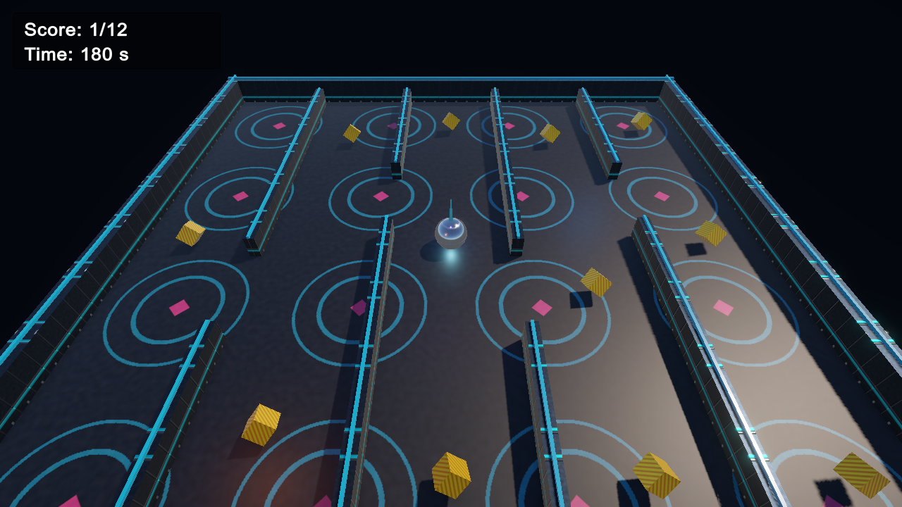

# RollABall · Neon Pinball

Ein kleines Unity-Spiel im Pinball-Look: Steuere eine Chromkugel durch ein leuchtendes Labyrinth und sammle alle zwölf goldenen Pickups ein, bevor die Zeit abläuft.

**Gameplay-Videos:** [Minimalversion ansehen](Submission/Starke_Vock_Duske_minimal.mp4) · [Bonusfunktionen ansehen](Submission/Starke_Vock_Duske_bonus.mp4)

## Starten

1. Das Projektverzeichnis in **Unity Hub** öffnen. Verwendet wurde **Unity 6.3 LTS, Editor 6000.3.27f1**.
2. Die Szene [`Assets/Scenes/rollaball.unity`](Assets/Scenes/rollaball.unity) öffnen.
3. Im Unity Editor auf **Play** klicken.

Das Projekt nutzt die **Universal Render Pipeline (URP)** und das **Unity Input System**. Die Szene ist in den Build Settings eingetragen.

## Steuerung und Spielziel

| Taste | Aktion |
| --- | --- |
| Pfeiltasten oder WASD | Kugel rollen |
| R | Nach Sieg oder Zeitablauf neu starten |

Sammle alle **12 Pickups** innerhalb von **180 Sekunden**. Der Punktestand und die Restzeit stehen oben links. Bei vollständiger Sammlung erscheinen eine Siegmeldung und Konfetti; nach Ablauf der Zeit erscheint „Time’s up!“.

## Umsetzung

- Physikbasierte Bewegung per `Rigidbody.AddForce` in `FixedUpdate` und Einsammeln über Trigger-Kollisionen.
- Kamera mit weichem Follow-Verhalten in `LateUpdate`.
- Vier sichtbare Außenwände, acht dünne Labyrinthwände und vier **zusätzliche unsichtbare Sicherheitswände**, die ein Verlassen des Spielfelds verhindern.
- Selbst erstellte Pinball-Texturen und Materialien für Spielfeld, Metallwände und goldene Pickups; Chromoptik, Licht und Spur für die Kugel. Wand- und Kugelmaterial verwenden wie in der Unity-Einführung **Base Map, Normal Map und Metallic Map**. Die PNG-Dateien liegen unter `Assets/Textures`, die Materialdateien unter `Assets/Materials`.
- Drei zusätzliche farbige Lichter, Sammelton, Punktestand, Countdown und Sieg-Konfetti.

### Bonusaufgaben aus dem Übungsblatt

| Aufgabe | Inhalt | Mögliche Punkte |
| --- | --- | ---: |
| 7a | Ton beim Einsammeln | 0,3 |
| 7b | Acht Labyrinthwände | 0,3 |
| 7c | Gestaltung von Boden, Wänden, Spieler und Pickups | 0,4 |
| 7d | Drei zusätzliche Lichter | 0,2 |
| 7e | Weiche Kamerabewegung | 0,1 |
| 7f | Punktestand | 0,3 |
| 7g | Countdown und Zeitablaufmeldung | 0,4 |
| 7i | Siegmeldung | 0,3 |
| 7j | Konfetti beim Sieg | 0,7 |

Das ergibt **3,0 mögliche Punkte**; laut Aufgabenblatt werden höchstens **2,5 Bonuspunkte** angerechnet. Die Aufgaben **7h** (fünf zusätzliche 3D-Assets) und **7k** (vollständiges neues Thema einschließlich Musik und Assets) sind nicht als abgeschlossen angegeben. Die unsichtbaren Sicherheitswände sind eine zusätzliche Funktion außerhalb der Bonusliste.

## Videos und Abgabe

| Datei | Inhalt |
| --- | --- |
| [Minimalversion (MP4)](Submission/Starke_Vock_Duske_minimal.mp4) | Spielfeld, Bewegung und Einsammeln |
| [Bonusfunktionen (MP4)](Submission/Starke_Vock_Duske_bonus.mp4) | Labyrinth, Gestaltung, Punktestand, Sieg, Konfetti und Zeitablauf |
| [Bonusliste (TXT)](Submission/Starke_Vock_Duske.txt) | Aufstellung der umgesetzten Aufgaben und Hinweise zur Aufnahme |
| [Abgabe-ZIP](Submission/Starke_Vock_Duske.zip) | Die beiden MP4-Dateien und die Bonusliste |

Die Videos wurden aus dem laufenden Spiel mit einer reproduzierbaren automatisierten Route aufgenommen. Für die Zeitablauf-Szene im Bonusvideo wurde der Countdown **nur in der Aufnahme** auf fünf Sekunden gesetzt; die eigentliche Unity-Szene verwendet 180 Sekunden.

## Team

Starke · Vock · Duske
